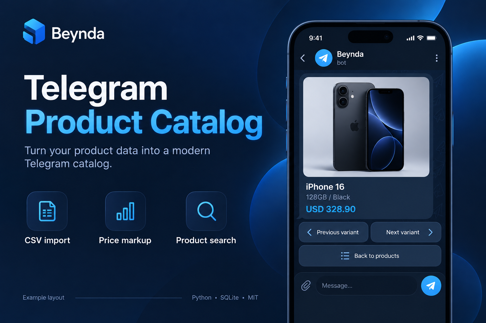

# Telegram Product Catalog



Illustrative example layout, not a screenshot of a live Telegram session.

A self-hosted product catalog with CSV import, SQLite storage and configurable price markup. Browse categories and product variants in Telegram, search product names, and export retail prices locally.

The included catalog contains six sample variants with synthetic prices, not sales offers. You can replace it with your own products. No supplier account, private channel, payment service or customer database is required.

## Features

- Import local CSV price lists. Validate the whole file before applying changes.
- Update included categories in one database transaction. Empty or invalid imports preserve existing data. Categories absent from an import are retained.
- Browse categories, products and variants with paginated Telegram buttons.
- Search product names and display up to 20 matches.
- Apply base, category or product percentage markup. Product rules override category rules, which override the base rule.
- Store money as integer minor units and round percentage calculations half up.
- Export retail prices to CSV with spreadsheet formula protection.
- Restrict the Telegram `/markup` command to allowlisted administrators in private chats.

This is a catalog, not a checkout system. Orders, payments, stock tracking and automatic supplier synchronization are not included.

## Requirements

Python 3.13 on Windows. The offline import, listing, markup and export commands use only the Python standard library. Telegram mode additionally requires the dependency in `requirements.txt` and your own BotFather token.

## Quick start on Windows PowerShell

Open PowerShell in the downloaded repository folder, then run:

```powershell
python -m venv .venv
.\.venv\Scripts\python.exe -m pip install -r requirements.txt
.\.venv\Scripts\python.exe -m app.cli import examples/catalog.csv --markup 10
.\.venv\Scripts\python.exe -m app.cli list
.\.venv\Scripts\python.exe -m app.cli export outputs/catalog.csv
```

These commands do not connect to Telegram or send messages. The default database is `data/catalog.sqlite3` inside the repository, regardless of your current working directory.

## Run your Telegram bot

Create a bot using Telegram's BotFather. Configure its token locally in your shell:

```powershell
$env:TELEGRAM_BOT_TOKEN = 'YOUR_BOT_TOKEN'
$env:ADMIN_USER_IDS = 'YOUR_NUMERIC_TELEGRAM_ID'
.\.venv\Scripts\python.exe -m app.cli bot
```

Open your bot in Telegram and send `/start`. Send a product name to search. An administrator can send `/markup 15` in a private chat to set the base percentage. If no administrator IDs are configured, this command is denied to everyone.

Never commit your token, database or personal product data. Telegram polling requires network access and sends catalog messages to people interacting with your bot. Only one polling process should use a bot token at a time. Stop polling with Ctrl+C.

## Use your own price list

CSV must use UTF-8 encoding and these columns:

| Column | Required | Meaning |
| --- | --- | --- |
| category | Yes | Category name, also used as its stable import key |
| product | Yes | Product name within the category |
| variant | Yes | Unique variant name within that product |
| cost | Yes | Supplier cost with at most two decimal places, e.g. `299.00` |
| storage | No | Capacity or size |
| color | No | Color label |
| description | No | Short description, at most 500 characters |

Names must contain 1 to 120 characters. Duplicate category/product/variant rows are rejected. Costs must be positive and at most 10,000,000 currency units. The currency is a display label; the program does not convert exchange rates. Use one currency with two decimal places per database.

```powershell
.\.venv\Scripts\python.exe -m app.cli --currency EUR import my-products.csv --markup 15
.\.venv\Scripts\python.exe -m app.cli --currency EUR bot
.\.venv\Scripts\python.exe -m app.cli markup 12
.\.venv\Scripts\python.exe -m app.cli markup 8 --category 1
.\.venv\Scripts\python.exe -m app.cli markup 5 --product 1
```

Use `list` to inspect product IDs. Category IDs can be read from the local database. The `--markup` import value is a fallback for products without saved rules. Saved rules persist across reimports. Renaming a category or product changes its rule key. Imports replace the included categories; they do not delete categories missing from the CSV. Stop the bot before importing to avoid stale menu buttons.

## Product photos

Selected product photos are bundled for the example catalog. Their sources and separate licensing are recorded in `assets/product_photos/SOURCES.md`. They are not covered by the code's MIT license. No affiliation with the manufacturers is implied.

The mapping in `app/media.py` connects product names to bundled photos. You can edit it for your products. Custom JPG photos can be placed in `data/photos/<product_id>.jpg` after import; `list` shows the IDs. These custom images override the bundled mapping. Photos are sent alongside product details. IDs can change when categories are reimported, so update custom filenames after an import. Runtime photos are ignored by Git. Use images you have permission to use.

## Tests

```powershell
.\.venv\Scripts\python.exe -m unittest discover -s tests -v
```

Tests use temporary databases and mock Telegram calls. They do not contact Telegram or send messages. This initial release has passed 23 local tests, but has not been tested against a live Telegram bot. Validate Telegram behavior with your own bot before relying on it. Report reproducible problems through GitHub Issues.

## License

Code is licensed under MIT; see `LICENSE`. Photos are excluded from that license; see `assets/product_photos/SOURCES.md`. Third-party dependencies retain their own licenses.

